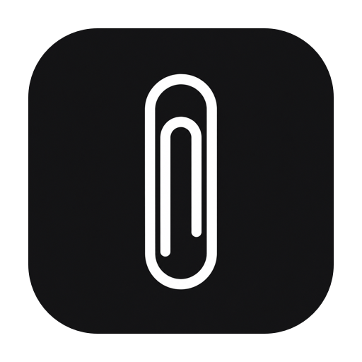
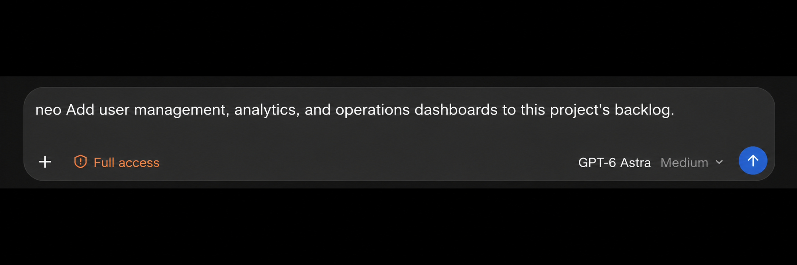
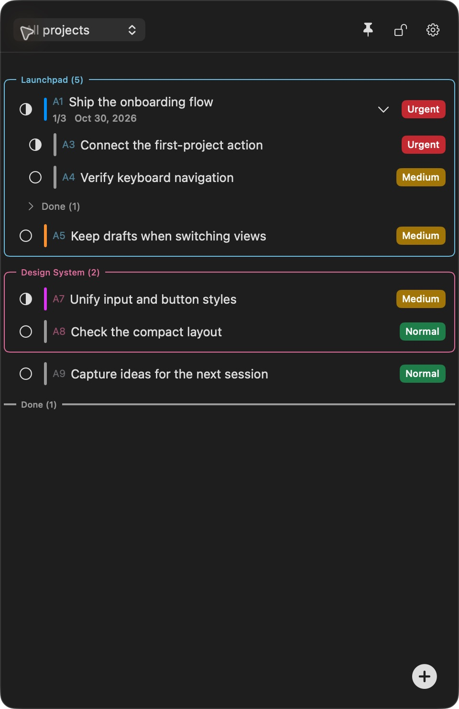
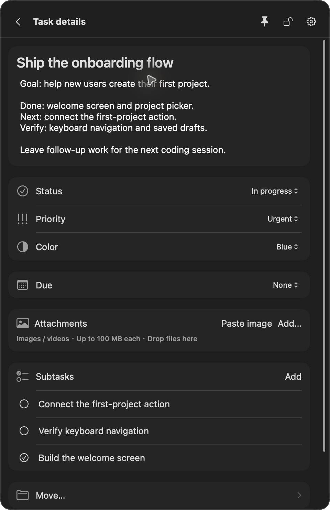
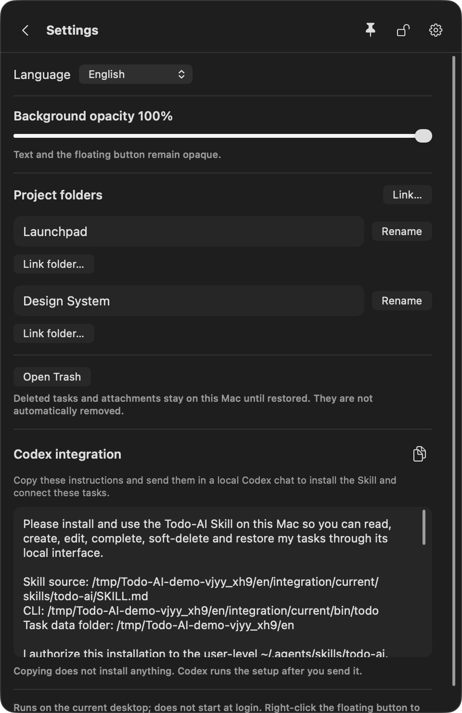

<div align="center">



# Next One

**One task list. Shared context. You and your coding agent.**

A local macOS floating todo app for vibe coding—keep plans, progress, and next steps visible while you build with AI.

**English** · [简体中文](docs/readme/README.zh-CN.md) · [日本語](docs/readme/README.ja.md) · [한국어](docs/readme/README.ko.md)

macOS 14+ · SwiftUI + AppKit · Local storage · Codex Skill + CLI

</div>

**[Download the macOS preview](https://github.com/Lucas-Qinlj/Next-One/releases/tag/v0.1.0-preview.1)** · Apple Silicon · macOS 14+ · Unsigned / not notarized · Noncommercial use only.

**Version note:** the features below describe current `main`. The linked `v0.1.0-preview.1` download predates these updates; build current source to use them.

**Keep it on top. Tune the transparency. Copy a ready-made setup instruction to your agent.**

## Why Next One?

Coding with AI moves fast. Keeping track of the work often doesn't.

A follow-up gets buried in a chat. A new session needs the same explanation again. Your own checklist and the agent's understanding drift apart. Switching projects makes it harder to remember what was actually finished and what still needs checking.

**Next One gives you and your coding agent one persistent, project-aware task list to maintain together.** You work in a small floating app; the agent reads and updates the same local data through a CLI. Keep the goal, progress, acceptance criteria, and unfinished work attached to the task, ready for the next session to read.

It is built for solo developers, indie makers, and anyone who builds software through conversation with coding agents. The included integration targets **Codex**; other local agents can use the documented CLI, but dedicated integrations have not been verified.

## Just start with `neo`

Install or update the `next-one` Skill from **Settings → Codex integration**, and make sure your local coding agent can discover it. Then write `neo` followed by what you want to record or change.



*Illustrative input example based on a Coding Agent composer. It shows an unsent request, not a successful execution. The model and permission controls reproduce the reference UI; they are not Next One requirements.*

> neo Read the PRD, break it into tasks, and prioritize by architecture dependencies. No coding yet.

| When this happens | Tell your agent | What stays in Next One |
| --- | --- | --- |
| A long PRD makes it hard to start | `neo Turn docs/PRD.md into tasks and subtasks for this project, with acceptance criteria for each. No coding yet.` | An actionable backlog without manually copying the requirements |
| Code moves fast; dependencies get overlooked | `neo Reorder tasks using the existing architecture: data models and APIs before UI integration. Set priorities and note dependencies and reasons.` | Execution order, priorities, and reasoning you can review |
| A product idea interrupts focused work | `neo Capture an idea: give new users a sample project on first launch. Low priority; mark it for validation. Do not implement it yet.` | An idea saved without treating it as an approved requirement |
| Your boss adds work before a demo | `neo My boss needs data export and permission guidance before this Friday’s demo. Add two high-priority tasks and keep the existing backlog.` | The request, deadline, and urgency without losing the original plan |
| A new agent session needs the context again | `neo Mark only verified work complete. Record failing tests, blockers, and where to resume on the relevant tasks.` | A handoff with actual progress and unfinished checks |
| Tomorrow’s demo is close; what is still missing? | `neo Review the tasks and acceptance notes for tomorrow’s demo. Rank unfinished items by impact; do not count unverified work as done.` | Gaps grounded in the saved work rather than assumed completion |

Turn requirements into a backlog, keep interruptions from getting lost, and leave a usable handoff for the next session. The agent reads the documents you specify and accessible project context, then writes its breakdown and architectural reasoning into tasks, subtasks, priorities, and notes. Dependencies are notes, not an automatic scheduling engine. Missing documents, unclear projects, and ambiguous task matches are clarified before writing; success is reported only after the write succeeds.

This is a Skill convention, not a shell command or background listener. The bundled setup targets Codex; discovery depends on your agent and installed Skill version. Fresh-session automatic routing has not yet been verified.

## A look inside

<table>
<tr>
<th align="left">Keep the work in view</th>
<th align="left">Leave context with the task</th>
</tr>
<tr>
<td width="50%"></td>
<td width="50%"></td>
</tr>
</table>

Actual macOS app captures with fictional demo tasks. The app supports Simplified Chinese, English, Japanese, and Korean. Choose a language or System default at the top of Settings; changes apply immediately and are remembered. Your task and project content stays unchanged.

## Highlights

| Feature | What it helps you do |
| --- | --- |
| **Apple Reminders + Calendar** | Sync dated tasks to a chosen Reminders list, view them in Calendar, and receive completion updates from iPhone. Opt-in; see setup below. |
| **Shared human–agent context** | Read and edit the same tasks from the app and CLI. Agent writes appear in the running app; the CLI also works while the app is closed. |
| **Project-aware handoffs** | Bind folders to projects and retrieve the right context from the working directory. Explicitly bind additional worktrees to the same project. |
| **Always-on-top workspace companion** | Keep the checklist visible alongside your editor or agent chat, so checking the next step does not mean switching to another task app. Move, resize, or collapse it from the floating ball. |
| **Adjustable transparency** | Set background opacity from 0% to 100%. Keep the panel less visually intrusive while task text and the floating button remain opaque. |
| **Copy-and-send agent setup** | Copy a ready-made, localized Codex setup instruction from Settings. It includes the actual Skill, CLI, and data paths, so you do not have to assemble the setup prompt yourself. |
| **Tasks that keep their context** | Organize up to ten levels of subtasks, with descriptions, status, priority, color, and a due date or time. |
| **Flexible organization** | Collapse project groups, reorder tasks and groups, move branches, and group unclassified tasks into a project. |
| **Autosave with conflict handling** | Details save after editing pauses. Different-field changes can merge; conflicting edits keep your draft and ask you to resolve them. |
| **References and recovery** | Attach images and videos as managed local copies, up to 100 MB per file. Restore deleted tasks and attachments from the trash. |
| **Local by design** | SwiftUI, AppKit, and system SQLite. No Next One account, cloud backend, or additional AI API key required. |

Lock mode makes the panel ignore mouse input while the floating ball remains available to unlock it. Some cross-app and desktop combinations still need manual validation; see [current limitations](#current-status-and-limitations).

## Sync with Apple Reminders and Calendar

**Give a task a due date, see it in Calendar, and mark it complete on your iPhone.** Next One writes to Apple Reminders; Calendar displays those scheduled reminders. It does not create separate calendar events.

### Set it up

1. For Mac–iPhone sync, sign in to the same Apple Account on both devices and enable iCloud Reminders. Create a dedicated list in Reminders, such as “Next One”.
2. Open **Next One → Settings → Sync to Calendar**, allow Reminders access, select the target list by its account and name, and confirm. Sync is off by default; the list picker refreshes every two seconds while Settings is open.
3. Give an unfinished task a due date or time. Initial sync includes dated unfinished tasks across all projects; undated tasks stay local. A reminder title looks like `A1-Prepare the demo`.
4. In Apple Calendar, enable **Scheduled Reminders** in the calendar list. Calendar integration requires **macOS 15+ / iOS 18+**; the base Next One app still supports macOS 14+. See [Apple’s Calendar guide](https://support.apple.com/guide/calendar/use-reminders-icl873b9a527/mac).
5. Allow Reminders notifications if you want alerts. A future due time adds an ordinary alert; a date without a time does not get an app-defined alert time. Delivery depends on system notification, Focus, and iCloud settings.

### What stays in sync

| Action or content | Behavior |
| --- | --- |
| Title, text notes, priority, due date/time | Published from Next One to the selected list, with project and parent-path context in notes. Dated subtasks appear as separate reminders. |
| Complete or uncomplete a linked reminder on the phone | Returns to Next One while the Mac app is running, or on its next launch. Completing a parent with unfinished children asks you how to handle them. |
| Edit, complete, delete, archive, or remove the due date in Next One | Updates the linked reminder; deletion, archiving, or removing its date removes that linked reminder. Other reminders in the list are left alone. |
| Add, rename, move, or delete items in Apple apps | Not a general two-way import. New reminders are not imported; conflicting changes to linked items pause that item for review in Settings. |
| Turn sync off or change lists | Turning it off keeps existing reminders. Changing the target requires confirmation and moves managed items. |
| Photos, videos, and other attachments | Stay local; they are not sent to Reminders. |

Keep Next One running for ongoing sync. CLI edits made while it is closed remain saved locally and sync after the next launch; CLI success does not mean iCloud delivery is complete. High priority does **not** automatically enable Apple’s **Urgent** alarm.

Mac/iPhone Calendar display, completion feedback, and an ordinary notification have been verified in the test environment. Offline, sleep, permission-revocation, and cross-account edge cases are not fully verified; see the [sync acceptance report](docs/acceptance/calendar-reminders-sync.md).

## Recent improvements (October 2026)

- **Lock and hover:** pin and lock the panel, then move the pointer over it to make its background fully transparent and its other content 50% opaque. Moving away or unlocking restores the original appearance without changing your saved opacity. The floating ball stays opaque and usable for unlocking.
- **Edge-aligned scrollbars:** 3 pt thumbs sit against each scroll container’s right or bottom edge while retaining the native drag area.
- **Short codes and completed work:** tasks show short codes such as `A1`; completed root tasks share a collapsible section at the bottom. When a live code reaches four characters, an archive prompt can move completed tasks across all projects to the trash and free their codes. Recovery assigns available codes again, so agents must resolve a code to its UUID before writing.
- **Gentler default priority:** new tasks default to Normal; existing priorities are unchanged.

## Keep your workflow in view

**Keep your next step beside your code.** Use the pin button to keep Next One above ordinary windows on the current desktop. Collapse it to the floating ball when you need more space, then expand it to check progress without hunting through another app.

**Choose how much presence it has.** Adjust **Background opacity** in Settings from **0%–100%**. Outside locked-hover mode, only the background becomes transparent; text and the floating button remain clear. Pinning and opacity are independent controls, so you can choose the balance that suits your workspace.

**Start sharing tasks with a copy and a paste.** In **Settings → Codex integration**, click the copy icon and paste the complete instruction into a local Codex chat. The app prepares the paths and setup steps, including preserving existing Skill customizations and read-only verification. The instruction follows your selected UI language. Sending it asks Codex to perform the setup; copying alone does not install anything. This built-in instruction targets Codex; other coding agents can use the documented local CLI.

<p align="center"></p>

*Historical settings capture from before the rename; use the paths copied from your current app, not the paths pictured here.*

## How you and the agent work together


1. **Capture the work.** Create a project, bind its folder, and add the goal, constraints, and acceptance criteria.
2. **Start with context.** Ask Codex to read that project's open tasks before making changes.
3. **Keep progress shared.** Edit priorities and notes in the app while the agent records actual progress through the CLI.
4. **Leave a useful handoff.** Record completed work and remaining checks in the task. A later local session can read the same list instead of reconstructing it from chat history.

After setting up the integration, try a request like:

> Read this project's Next One tasks. Work on the onboarding flow, record confirmed follow-up work as subtasks, and update progress based on what you actually verify. Preserve my existing notes.

The app and agent use one business-rule layer and one local store:

```text
You ─────────── macOS app ──────┐
                               ├── Shared validation ── Local tasks + attachments
Coding agent ── Skill / CLI ────┘
```

This is explicit collaboration: Next One does not listen to every chat, run agents in the background, or automatically synchronize remote environments.

## Quick start

### Build and run

Requirements: **macOS 14 or later**, a **Swift 6.0+ toolchain** (such as a compatible Xcode installation), and Python 3 for the packaging script. There are no third-party runtime dependencies.

```sh
git clone https://github.com/Lucas-Qinlj/Next-One.git
cd Next-One
./scripts/run.sh
```

This builds and launches `.build/Next One.app`, including its CLI and Skill resources. It does not install the app into Applications. This is a local development build, not a signed and notarized distribution.

- Click the floating ball to show or hide the list; drag it to move the app.
- Use **+** to add a task, and click a task title to edit its details. Changes autosave.
- Open **Settings** to bind a project folder and find **Codex integration**.
- Right-click the ball to lock, unlock, or quit. The menu-bar entry can bring the ball back into view.
- Shortcuts: `⌘B` recover the ball, `⌘T` toggle the list, `⌘,` open Settings, `⌘Q` quit.

### Connect Codex

1. Launch Next One and open **Settings → Codex integration**.
2. Copy the installation instruction and send it in a **local Codex session on the same Mac**. The instruction asks that session to install the bundled Skill, preserve existing customization, and verify the CLI using read-only commands.
3. Bind a project folder for project work; standalone personal tasks can stay in Unfiled. Additional worktree folders must be explicitly bound.
4. Once the updated Skill is available, send a `neo` request. If it is not discovered, refresh or restart the agent session.

Copying the instruction alone does not install anything. App startup prepares bundled integration resources inside the app's data directory; it does not modify your global Skills or Codex configuration. Automatic discovery after installation still needs validation in a fresh target session.

See the [included Skill](Skills/next-one/SKILL.md), [CLI reference](Skills/next-one/references/cli.md), and [optional working rules](docs/codex-rules-snippet.md). The Skill, its references, and the optional working-rule snippet are written in English. Requests and task content can remain in your own language.

### Use the CLI directly

Run these from the repository root after building:

```sh
.build/debug/todo --help
.build/debug/todo project bind --path "$PWD" --name "Next One"
.build/debug/todo context --cwd "$PWD" --json
```

The bind command creates or associates a project with this checkout. For another project, supply its directory instead. Commands return structured JSON; failures return an error code and a nonzero exit status.

Updates require the task's latest `revision`. Creation supports stable request keys to avoid duplicates on retries. Both interfaces enforce the same hierarchy, project, and status rules—agents should use the CLI, never edit the database directly.

## Data and privacy

- Release uses `~/Library/Application Support/Next-One-Release`; debug uses `~/Library/Application Support/Next-One`. If only the same-channel legacy folder exists, the new path links to that store, preserving tasks, attachments and preferences without copying or merging. Existing new folders take precedence; a fresh install with neither folder starts empty. Development and release data stay separate.
- Update an older Skill using the instruction in the current app: the Skill is `next-one`, the exported CLI is `integration/current/bin/next-one`, and `NEXT_ONE_HOME` overrides the data directory. The old `TODO_AI_HOME` remains a compatibility fallback; the new variable takes priority. Copying the instruction alone does not update a global Skill.
- Imported attachments are copied into managed storage. Moving the original file does not remove the imported copy. Video playback depends on the system's default media application.
- Deleted tasks and attachments remain recoverable; there is no automatic trash cleanup.
- Reminders sync is off by default. If enabled, task text, dates, priorities, and completion state are written to the selected Apple account’s Reminders list and may sync through iCloud; attachments stay local. Content you explicitly ask a coding agent to read enters that agent's context and is subject to its own data handling.
- To back up, quit the UI and stop CLI writes, then copy the entire data directory, including SQLite/WAL files and attachments.

For an isolated demo or test, use the **same** `NEXT_ONE_HOME` for both app and CLI:

```sh
NEXT_ONE_HOME="$PWD/.local/demo" ./scripts/run.sh
# In another terminal, from the same repository:
NEXT_ONE_HOME="$PWD/.local/demo" .build/debug/todo project list
```

Use one UI instance per data directory; CLI calls can run concurrently.

## Development

```sh
swift build
swift test
python3 scripts/cli-smoke.py
python3 scripts/drag-cli-smoke.py
./scripts/package-app.sh release
```

The release command creates an optimized local app bundle at `.build/Next One.app`; it does not sign, notarize, install, or publish it. Keep the complete bundle, including its CLI and Skill resources.

| Area | Responsibility |
| --- | --- |
| [TodoCore](Sources/TodoCore/README.md) | Persistence, transactions, task rules, and conflict checks |
| [TodoApp](Sources/TodoApp/README.md) | Floating windows, task UI, and local integration preparation |
| [TodoCLI](Sources/TodoCLI/README.md) | Structured local interface for agents and scripts |
| [Skills/next-one](Skills/next-one/SKILL.md) | Codex task-reading and update conventions |

For a local drag-to-Applications installer, run `./scripts/package-dmg.sh`. The DMG and SHA-256 checksum are written to `.local/releases/`; see the [local installation guide](docs/distribution/local-install.md) (Chinese). This trial package is not Developer ID signed or notarized.

## Current status and limitations

The native app and CLI are implemented and have been built and run on Apple Silicon. This is an early local development version; not every acceptance scenario has passed.

- Signed/notarized downloads, cross-machine distribution, and cross-architecture validation are not complete.
- Full validation of click-through input reaching other apps, multi-display changes, Spaces, full-screen apps, and Stage Manager remains incomplete.
- Some media interactions and fresh-session Skill discovery still need end-to-end checks.
- There is no full Next One database/attachment cloud sync or team workspace. Optional Apple Reminders sync covers the fields above; it does not provide remote-agent access to this Mac.
- The pixel-aquarium experiment under `docs/` is a separate prototype, not a feature of the native app.

See [project status](PROJECT_STATUS.md), the [acceptance report](docs/acceptance/macos-floating-todo.md), and the [product specification](docs/spec/2026-10-24/macos-floating-todo.md) for evidence and remaining work.

## Contributing

Bug reports, reproducible examples, documentation improvements, and focused changes are welcome. For bugs, include your macOS version, build steps, expected behavior, and actual behavior. Use demo data and remove private tasks, paths, and credentials from reports.

Before making changes, read [AGENTS.md](AGENTS.md) and the relevant specification. Keep the product focused on a simple, local workflow for one person and their coding agent. Verify behavior changes with the relevant tests and real macOS interaction where needed.

## License

**Noncommercial use only.** Next One is licensed under the [PolyForm Noncommercial License 1.0.0](LICENSE). Noncommercial use, modification and redistribution are allowed subject to its terms; commercial use is not licensed. Preserve the license and [required notice](NOTICE) when distributing copies. This is source-available software with noncommercial restrictions, not an unrestricted open-source license. Third-party components retain their own licenses.

After explicit setup authorization, `integration install` creates a managed Skill runner and a dedicated block in the active Codex rules file. App updates supply the latest workflow and CLI through `integration/current`; user preferences stay in `USER.md`. Setup refuses unmanaged or edited files. Use `integration status` to inspect and `integration uninstall` to remove only unchanged managed content. See [connection lifecycle](Skills/next-one/references/setup.md).
