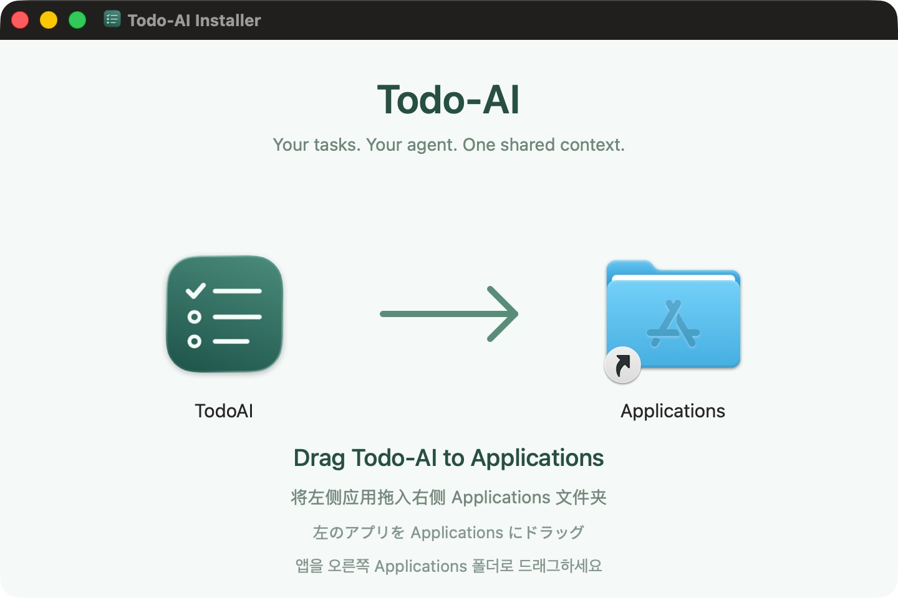

# 本机 DMG 试装

- 日期：2026-10-26
- 范围：本机 release 应用与 DMG 制作，供用户手动拖入 Applications 试装。不是签名公证或公开发布。
- 版本：0.1.0 本地试装版，build 3；文件名同时包含本机架构和源码提交标识。首次交付目标为 Apple Silicon（arm64），macOS 14+。

## 安装窗口



本轮改为固定 720 × 480 pt 的 Finder 图标窗口：左侧应用、右侧 Applications、中间箭头，下方提供中英日韩拖拽提示。使用与悬浮球风格一致的清单图标，移除散落的 Install.txt。截图为实际打开 DMG 的结果，不是设计稿。

## 制作

```sh
./scripts/package-dmg.sh
```

需要既有 Swift 6+ 工具链、macOS 原生工具及 Python 3.10+ 的独立打包环境。首次准备（以下以本机 Python 3.13 为例）：

```sh
python3.13 -m venv .local/dmg-tools/venv
.local/dmg-tools/venv/bin/python -m pip install --only-binary=:all: --require-hashes -r scripts/distribution/requirements.txt
```

仅 DMG 打包依赖 dmgbuild 1.6.7、ds-store 1.3.3 和 mac-alias 2.2.3；应用运行没有新增依赖。锁文件包含版本和 wheel SHA-256，不安装全局包。可用 `TODO_AI_DMG_PYTHON` 指定已准备的同版本 Python 环境。产物位于忽略的 `.local/releases/`，包含 `.dmg` 和 SHA-256 校验文件；同名产物已存在时拒绝覆盖。

脚本复用 `package-app.sh release <临时应用路径>`，不会覆盖 `.build/Next One.app` 中正在使用的开发版。DMG 可见内容只有完整 `Next One.app` 与指向 `/Applications` 的快捷方式，安装指引直接显示在背景上。dmgbuild 负责 Finder 布局和 Retina 背景元数据；不通过 AppleScript 操控 Finder。安装版使用 local.todo-ai.release 标识和独立默认数据目录，保留 CLI、完整 Skill 与四语资源，不修改真实数据、全局 Skill 或系统设置。

`package-app.sh` 的第二个参数可省略；原有 debug/release 调用默认仍输出 `.build/Next One.app`。CLI/应用核心功能不变。

## 安装与启动

1. 通过悬浮球右键或应用菜单退出已运行的开发版。
2. 打开 DMG，将 `Next One.app` 拖到其中的 `Applications` 快捷方式。
3. 从“应用程序”打开 Next One；单击悬浮球显示清单。
4. 安装完成后推出磁盘映像。不要直接从只读映像长期运行应用。

安装版使用独立的 `~/Library/Application Support/Todo-AI-Release`，开发版保留 `~/Library/Application Support/Todo-AI`。旧版共用目录中的待办不会导入或删除；首次打开新版安装版时，若其独立目录尚不存在，则显示空清单。以后更新安装版保留其自身数据。同一数据目录不要同时运行两个 UI 实例。安装前如需备份，退出 UI、停止 CLI 写入，再复制完整数据目录。仅移除 Applications 中的应用不会清除待办数据。

安装不自动安装全局 Skill。需要接入时在设置中复制当前生成的 Codex 指令，再发送给本机 Codex 会话。旧全局 Skill 可能仍指向开发数据，请从新版设置复制接入指令重新接入；不自动覆盖已有全局 Skill。开发版与新版安装版可以分别使用各自数据，不能假设两个清单会同步。

## 验证边界

DMG 完整性、完整资源、从映像复制到独立目录后的启动与 CLI 接入检查属于本机试装前验证。实际拖入 Applications 并使用安装版独立数据由用户试装，不将隔离验证表述为用户已安装。

该包未进行 Developer ID 签名或 Apple 公证。不给出绕过系统安全设置的脚本；其他 Mac、网络下载后的 Gatekeeper 行为、Intel 架构以及此前未验收的窗口/桌面组合不属于本次通过范围。正式公开发行需单独完成签名、公证与分发验证。

## 维护与验证

- [工具与 Skill 比较、正式发布流程](../research/2026-10-26-macos-release-tools.md)。本轮仅参考专业 Skill，不安装全局 Skill，不启用 Sparkle、不发布 GitHub Release、不处理签名凭据。
- 图标/背景资源及重生成方式见 [Resources/Distribution](../../Resources/Distribution/README.md)。主构建脚本使用已提交的资源，不要求每次重画图标。
- 生成后 `hdiutil verify` 和 SHA-256 检查完整性；实际双击 DMG 检查窗口，避免仅确认文件存在而遗漏显示问题。
- 挂载后可运行以下只读检查（路径以实际卷名为准）：

```sh
.local/dmg-tools/venv/bin/python scripts/distribution/verify-mounted.py '/Volumes/Next One Installer'
```

脚本检查图标、四语资源、完整 Skill、Applications 链接、背景与图标左右关系，并调用包内 CLI --help。检查不安装应用、不修改真实待办。更换 macOS 或打包依赖后仍需实际 Finder 检查。
