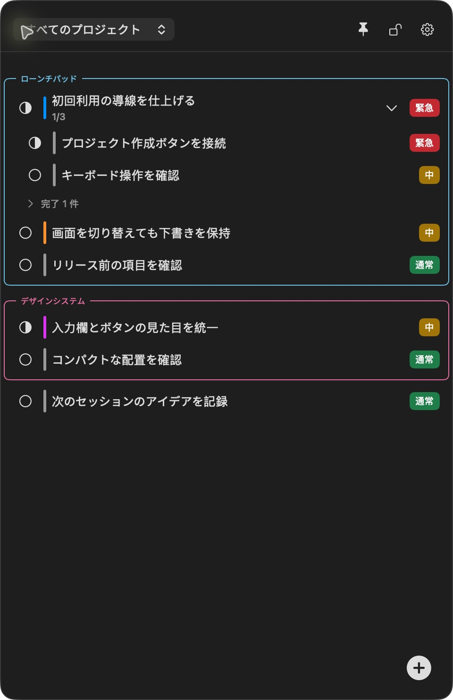
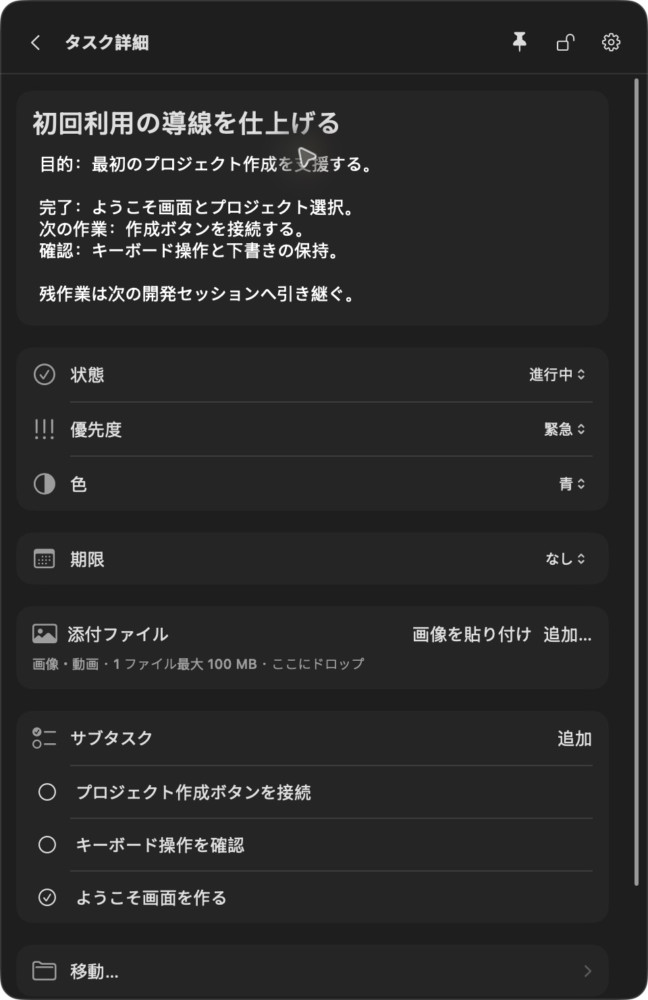
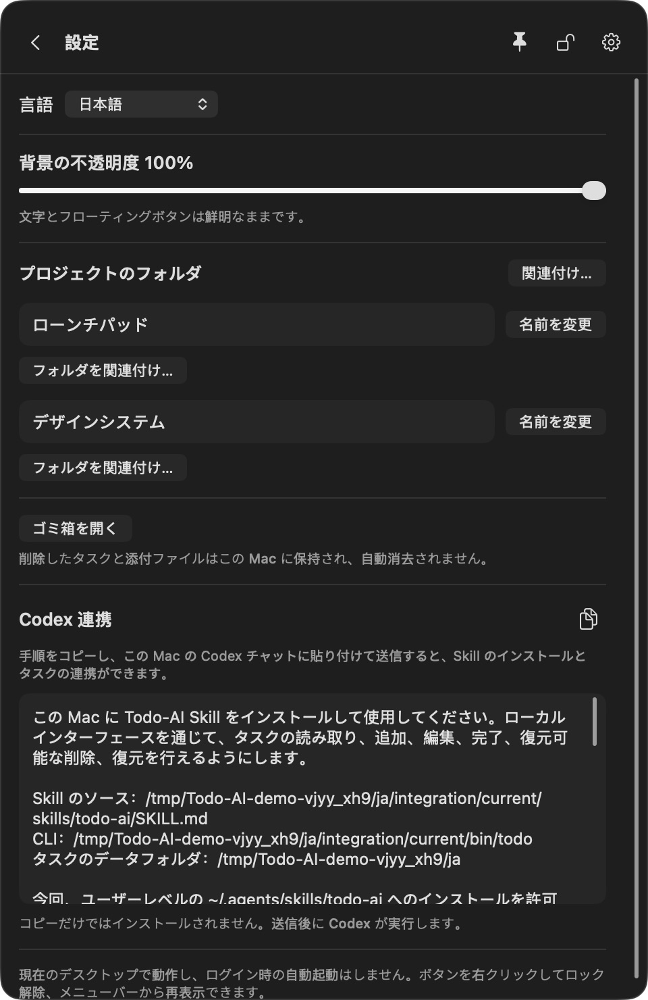

<div align="center">

# Todo-AI

**あなたと Coding Agent が、ひとつのタスクリストとコンテキストを共有。**

Vibe Coding のためのローカル macOS フローティング ToDo アプリ。AI と開発しながら、計画・進捗・次の作業をいつでも確認できます。

[English](../../README.md) · [简体中文](README.zh-CN.md) · **日本語** · [한국어](README.ko.md)

macOS 14+ · SwiftUI + AppKit · ローカル保存 · Codex Skill + CLI

</div>

**最前面に表示。不透明度を調整。用意された設定手順を Agent にコピー。**

## なぜ Todo-AI？

AI とコードを書くスピードに、タスク管理が追いつかないことがあります。

「あとで対応する」作業がチャットに埋もれる。新しいセッションで、同じ背景を説明し直す。自分のチェックリストと Agent が把握している進捗がずれていく。複数のプロジェクトを切り替えるうちに、完了した作業と未検証の作業が分からなくなる。

**Todo-AI は、人と Coding Agent が一緒に更新できる、プロジェクト単位の永続的なタスクリストを提供します。** あなたは小さなフローティングアプリで操作し、Agent は CLI 経由で同じローカルデータを読み書きします。目的、進捗、受け入れ条件、残作業をタスクに残すことで、次のセッションもそこから始められます。

個人開発者や、Coding Agent との対話でソフトウェアを作る人のためのツールです。同梱の連携は **Codex** 向けです。他のローカル Agent も公開 CLI を利用できますが、専用の連携は検証していません。

## スクリーンショット

<table>
<tr><th align="left">作業をいつも見える場所に</th><th align="left">背景情報をタスクに残す</th></tr>
<tr>
<td width="50%"></td>
<td width="50%"></td>
</tr>
</table>

実際の macOS アプリを、架空のデモタスクで撮影しています。アプリは簡体字中国語、英語、日本語、韓国語に対応しています。設定の上部で言語または「システムに従う」を選択すると、すぐに反映され、選択が保存されます。タスクとプロジェクトの内容は原文のまま保持されます。

## 主な機能

| 機能 | できること |
| --- | --- |
| **人と Agent のコンテキスト共有** | アプリと CLI から同じタスクを更新。Agent の変更は起動中のアプリに反映され、アプリを閉じていても CLI を使えます。 |
| **プロジェクトごとの引き継ぎ** | フォルダをプロジェクトに紐づけ、作業ディレクトリから対象のコンテキストを取得。追加の worktree も明示的に紐づけられます。 |
| **開発中も最前面に表示** | エディタや Agent のチャットのそばにリストを置き、別のタスクアプリに切り替えず次の作業を確認できます。移動・サイズ変更・ボタンへの折りたたみに対応。 |
| **調整できる透明度** | 背景の不透明度を30%〜100%に設定。文字とフローティングボタンの読みやすさを保ちながら、パネルの存在感を抑えられます。 |
| **コピーして送るだけの連携手順** | 設定から選択中の言語の Codex 設定手順をコピー。実際の Skill・CLI・データのパスが含まれるため、自分で指示文を組み立てる必要がありません。 |
| **背景を持つタスク** | 最大10階層のサブタスクに、説明、状態、優先度、色、期限の日付または日時を設定できます。 |
| **柔軟な整理** | プロジェクトの折りたたみ、タスクやグループの並べ替え、サブツリーの移動、未分類タスクのプロジェクト化に対応。 |
| **自動保存と競合処理** | 入力が止まると詳細を保存。異なる項目の変更は統合でき、同じ項目の競合は下書きを保持して解決を求めます。 |
| **参考資料と復元** | 画像・動画を1ファイル最大100 MBのローカルコピーとして保存。削除したタスクや添付ファイルは復元できます。 |
| **ローカル中心の設計** | SwiftUI、AppKit、システム SQLite を使用。Todo-AI アカウント、クラウドバックエンド、追加の AI API キーは不要です。 |

ロック時はパネルがマウス入力を無視し、フローティングボタンから解除できます。アプリ間・デスクトップ環境ごとの一部動作は、引き続き手動検証が必要です。

## 開発の流れを止めずに使う

**次の作業を、コードのそばに。** ピンボタンで、現在のデスクトップの通常ウィンドウより前に Todo-AI を表示できます。スペースが必要なときはフローティングボタンに折りたたみ、進捗を見たいときに開けば、別のタスクアプリを探す手間が減ります。

**背景の見え方を自分に合わせる。** 設定の**背景の不透明度を30%〜100%**で調整できます。透明になるのは背景だけで、文字とフローティングボタンは鮮明なままです。最前面表示と不透明度はそれぞれ設定できます。

**設定手順はコピーして Agent に渡す。** **設定 → Codex 連携**のコピーアイコンを押し、ローカルの Codex チャットに全文を貼り付けて送信します。実際のパス、インストール手順、既存 Skill のカスタマイズの保持、読み取り専用の確認方法があらかじめ含まれています。手順は選択した UI 言語で表示されます。送信後に Codex が設定を行い、コピーだけではインストールされません。内蔵の手順は Codex 向けで、他の Coding Agent は公開 CLI を利用できます。

<p align="center"></p>

## 人と Agent の共同作業

1. **作業を記録する。** プロジェクトを作ってフォルダを紐づけ、目的・制約・受け入れ条件を書きます。
2. **コンテキストを読んで始める。** 変更前に、Codex にそのプロジェクトの未完了タスクを読ませます。
3. **進捗を共有する。** アプリで優先度やメモを調整しながら、Agent は CLI で実際の進捗を記録します。
4. **次に引き継ぐ。** 完了した作業と残りの確認事項をタスクに残します。次のローカルセッションは、チャット履歴から再構成せず同じリストを読めます。

連携を設定したら、例えば次のように依頼できます。

> このプロジェクトの Todo-AI タスクを読んで、オンボーディング画面の開発を進めてください。確定した追加作業はサブタスクにし、実際に検証できた結果に基づいて進捗を更新してください。既存のメモは残してください。

```text
あなた ─────── macOS アプリ ────┐
                               ├── 共通の検証処理 ── ローカルのタスク・添付ファイル
Coding Agent ── Skill / CLI ────┘
```

明示的な依頼に基づく連携です。すべてのチャットの監視、バックグラウンドでの Agent 実行、リモート環境との自動同期は行いません。

## クイックスタート

### ソースからビルドして起動

**macOS 14 以降**、**Swift 6.0 以降のツールチェーン**（対応する Xcode など）、パッケージ作成用の Python 3 が必要です。サードパーティ製のランタイム依存関係はありません。

```sh
git clone https://github.com/Lucas-Qinlj/Todo-AI.git
cd Todo-AI
./scripts/run.sh
```

CLI と Skill を含む `.build/TodoAI.app` をビルドして起動します。Applications へのインストールは行いません。署名・公証済みの配布版ではなく、ローカル開発用ビルドです。

- フローティングボタンをクリックして開閉、ドラッグして移動します。
- **+** でタスクを追加し、タイトルをクリックして編集します。変更は自動保存されます。
- **設定** でプロジェクトのフォルダを紐づけ、**Codex 連携** を開けます。
- ボタンの右クリックでロック・解除・終了。メニューバーからボタンを画面内に戻せます。
- ショートカット：`⌘B` ボタンを表示領域に戻す、`⌘T` 開閉、`⌘,` 設定、`⌘Q` 終了。

### Codex と接続する

1. Todo-AI の **設定 → Codex 連携** を開きます。
2. インストール用の指示文をコピーし、**同じ Mac 上のローカル Codex セッション**に送信します。指示文は、同梱 Skill のインストール、既存のカスタマイズの保護、読み取り専用コマンドによる CLI 確認を依頼します。
3. プロジェクトフォルダを紐づけ、Codex に Todo-AI のコンテキストを読ませます。追加の worktree は個別の紐づけが必要です。

コピーしただけではインストールされません。アプリの起動時に連携リソースを自身のデータディレクトリへ用意しますが、グローバル Skill や Codex 設定は変更しません。インストール後の自動検出は、新しい対象セッションでの検証が必要です。

[同梱 Skill](../../Skills/todo-ai/SKILL.md) · [CLI リファレンス](../../Skills/todo-ai/references/cli.md) · [任意の作業ルール](../codex-rules-snippet.md)。これらの詳細資料は現在、中国語で提供しています。

### CLI を直接使う

ビルド後、リポジトリのルートで実行します。

```sh
.build/debug/todo --help
.build/debug/todo project bind --path "$PWD" --name Todo-AI
.build/debug/todo context --cwd "$PWD" --json
```

bind コマンドは、このチェックアウトをプロジェクトとして作成または関連づけます。別のプロジェクトなら、そのディレクトリを指定してください。結果は構造化 JSON、失敗時はエラーコードと非ゼロの終了ステータスを返します。

更新には最新の `revision` が必要です。作成時には安定したリクエストキーを指定して再試行時の重複を防げます。階層・プロジェクト・状態のルールは UI と共通です。Agent はデータベースを直接編集せず、CLI を使ってください。

## データとプライバシー

- Release インストーラとその CLI は `~/Library/Application Support/Todo-AI-Release`、debug 開発版は `~/Library/Application Support/Todo-AI` を使います。タスク、添付ファイル、言語、ウィンドウ設定、連携リソースは別々です。インストール版の保存先がなければ空のリストで始まり、その後の更新では自身のデータを保持します。開発版のデータは取り込みも削除もしません。
- 以前の共有データ版から更新した場合、設定から新しい Codex 連携手順をコピーして再設定してください。既存のグローバル Skill は自動変更されません。新しい手順の CLI とデータパスを使ってください。`TODO_AI_HOME` はどちらの既定値よりも優先されます。
- 添付ファイルは管理用フォルダにコピーされるため、元ファイルを移動しても残ります。動画再生はシステム既定のメディアアプリに依存します。
- 削除したタスクと添付ファイルは復元でき、ゴミ箱の自動削除はありません。
- Todo-AI はタスクや添付ファイルを自動アップロードしません。Coding Agent に読み取りを依頼した内容は、その Agent のコンテキストに入り、当該サービスのデータ取り扱いに従います。
- バックアップ時は UI を終了し、CLI の書き込みを止めてから、SQLite/WAL と添付ファイルを含むデータディレクトリ全体をコピーします。

デモやテストでは、アプリと CLI に**同じ** `TODO_AI_HOME` を指定します。

```sh
TODO_AI_HOME="$PWD/.local/demo" ./scripts/run.sh
# 別のターミナルで、同じリポジトリから実行：
TODO_AI_HOME="$PWD/.local/demo" .build/debug/todo project list
```

データディレクトリごとに UI は1つだけ起動してください。CLI は並行実行できます。

## 開発

```sh
swift build
swift test
python3 scripts/cli-smoke.py
python3 scripts/drag-cli-smoke.py
./scripts/package-app.sh release
```

最後のコマンドは、最適化されたローカルアプリ `.build/TodoAI.app` を生成します。署名・公証・インストール・公開は行いません。移動する場合は CLI と Skill を含むバンドル全体を保持してください。

| モジュール | 役割 |
| --- | --- |
| [TodoCore](../../Sources/TodoCore/README.md) | 永続化、トランザクション、タスクのルール、競合検査 |
| [TodoApp](../../Sources/TodoApp/README.md) | フローティングウィンドウ、UI、ローカル連携の準備 |
| [TodoCLI](../../Sources/TodoCLI/README.md) | Agent とスクリプト用の構造化インターフェース |
| [Skills/todo-ai](../../Skills/todo-ai/SKILL.md) | Codex によるタスクの読み取り・更新の取り決め |

ローカルで試すには `./scripts/package-dmg.sh` を実行してください。Applications にドラッグしてインストールする DMG と SHA-256 チェックサムが `.local/releases/` に生成されます。[ローカルインストール手順](../distribution/local-install.md)（中国語）を参照してください。この試用版は Developer ID 署名・公証を行っていません。

## 現在の状態と制限

ネイティブアプリと CLI は実装済みで、Apple Silicon 上でビルド・実行しています。初期のローカル開発版であり、すべての受け入れシナリオを通過したわけではありません。

- 署名・公証済みダウンロード、別の Mac への配布、異なるアーキテクチャでの検証は未完了です。
- 背後のアプリへのクリック透過、ディスプレイ構成変更、Spaces、フルスクリーン、Stage Manager の網羅的な検証は未完了です。
- 一部のメディア操作と、新規セッションでの Skill 検出はエンドツーエンド検証が必要です。
- クラウド同期、チーム用ワークスペース、リモート Agent による本機データへの自動アクセスは提供しません。
- `docs/` のピクセル水槽は独立した試作で、ネイティブアプリの機能ではありません。

検証結果と残作業は[プロジェクト状況](../../PROJECT_STATUS.md)、[受け入れレポート](../acceptance/macos-floating-todo.md)、[製品仕様](../spec/2026-10-24/macos-floating-todo.md)を参照してください。

## コントリビューション

不具合の再現例、ドキュメント改善、範囲を絞った変更を歓迎します。不具合報告には macOS のバージョン、ビルド手順、期待する動作と実際の動作を記載してください。デモデータを使い、個人のタスク、パス、認証情報を除いてください。

変更前に [AGENTS.md](../../AGENTS.md) と関連仕様を確認してください。一人の開発者と Coding Agent のためのシンプルなローカルツールという方向性を保ち、動作変更は関連テストや必要な実機操作で確認してください。

## ライセンス

ライセンスは未選定で、現在 `LICENSE` ファイルはありません。ライセンス付きのオープンソースソフトウェアとして公開する前に、オープンソースライセンスを追加する必要があります。
