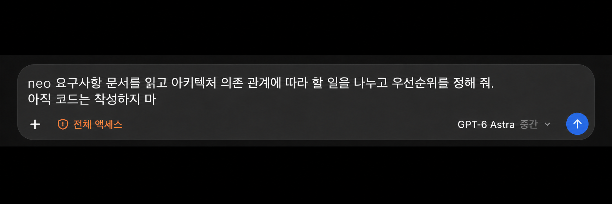
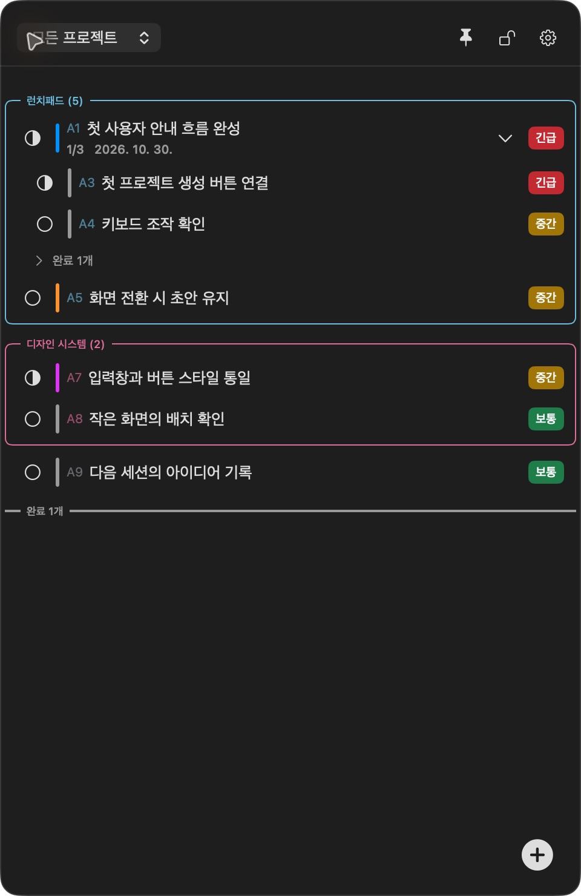
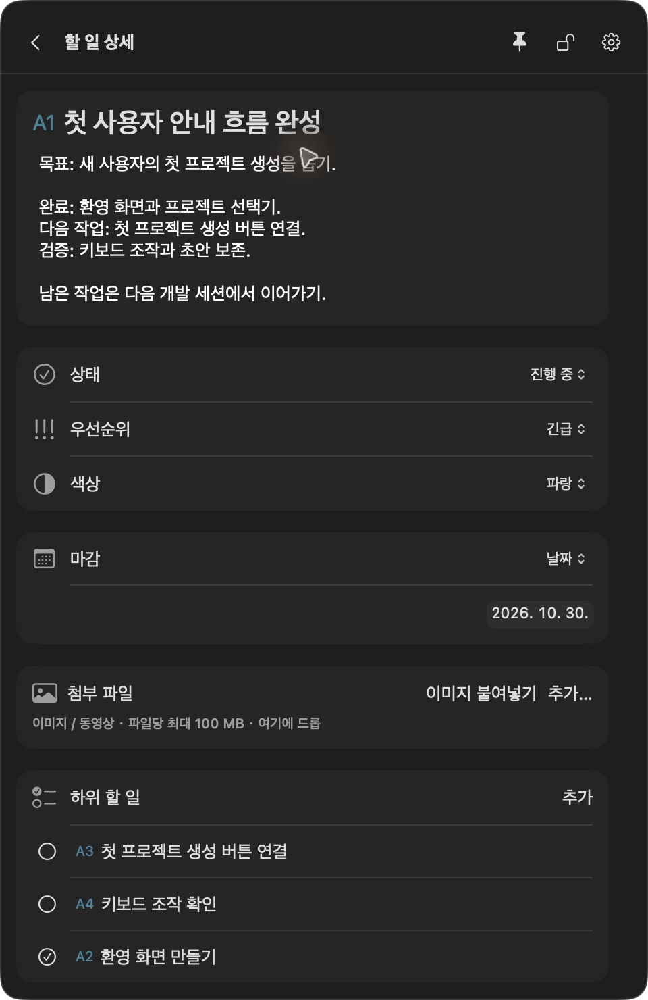
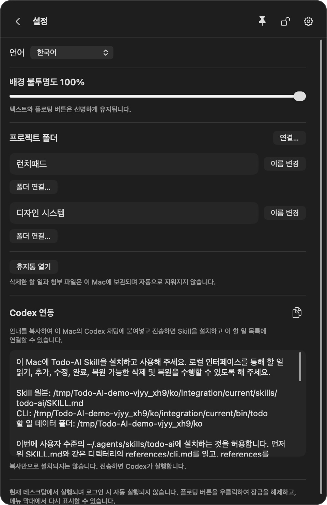

<div align="center">


# Next One

**하나의 할 일 목록, 같은 작업 맥락. 나와 Coding Agent가 함께 관리합니다.**

Vibe Coding을 위한 로컬 macOS 플로팅 할 일 앱. AI와 개발하는 동안 계획, 진행 상황, 다음 작업을 가까이 두세요.

[English](../../README.md) · [简体中文](README.zh-CN.md) · [日本語](README.ja.md) · **한국어**

macOS 14+ · SwiftUI + AppKit · 로컬 저장 · Codex Skill + CLI

</div>

**[Next One 0.2.0 다운로드 · 사전 출시](https://github.com/Lucas-Qinlj/Next-One/releases/tag/v0.2.0)** · Apple Silicon · macOS 14+ · Developer ID 서명 완료／공증 전 · 비상업적 사용만 허용.


**항상 위에 표시하고, 투명도를 조절하고, 준비된 설치 안내를 Agent에게 복사해 보내세요.**

## 왜 Next One인가요?

AI와 코드를 작성하는 속도에 작업 관리가 늘 따라오는 것은 아닙니다.

“나중에 처리하자”던 일이 채팅에 묻힙니다. 새 세션에서는 같은 배경을 다시 설명해야 합니다. 내 체크리스트와 Agent가 이해한 진행 상황이 달라집니다. 여러 프로젝트를 오가다 보면 정말 끝난 일과 아직 확인할 일을 구분하기 어려워집니다.

**Next One는 사람과 Coding Agent가 함께 업데이트하는, 프로젝트별로 저장되는 하나의 할 일 목록을 제공합니다.** 사용자는 작은 플로팅 앱에서 작업하고, Agent는 CLI를 통해 같은 로컬 데이터를 읽고 씁니다. 목표, 진행 상황, 완료 기준, 남은 작업을 할 일에 남겨 다음 세션에서도 이어갈 수 있습니다.

개인 개발자, 인디 메이커, Coding Agent와 대화하며 소프트웨어를 만드는 사람을 위한 도구입니다. 기본 연동은 **Codex**를 대상으로 합니다. 다른 로컬 Agent도 문서화된 CLI를 사용할 수 있지만, 전용 연동은 아직 검증하지 않았습니다.

## `neo`로 시작하세요

**설정 → Codex 연동**의 안내로 `next-one` Skill을 설치하거나 업데이트하고, 로컬 Coding Agent가 이를 찾을 수 있게 해 주세요. 그런 다음 `neo` 뒤에 기록하거나 변경할 내용을 입력하세요.



*Coding Agent 입력창을 참고한 예시 이미지입니다. 아직 보내지 않은 입력이며 실행 성공의 증거가 아닙니다. 모델과 권한 표시는 참고 화면을 재현한 것으로, Next One의 필수 사용 조건이 아닙니다.*

> neo 요구사항 문서를 읽고 아키텍처 의존 관계에 따라 할 일을 나누고 우선순위를 정해 줘. 아직 코드는 작성하지 마

| 막히는 순간 | Agent에게 요청하기 | Next One에 남는 내용 |
| --- | --- | --- |
| 긴 요구사항에서 어디부터 시작할지 모르겠을 때 | `neo docs/PRD.md를 현재 프로젝트의 할 일과 하위 작업으로 나누고 각각의 완료 기준을 적어 줘. 아직 코드는 작성하지 마` | 요구사항을 다시 옮겨 적지 않아도 실행 가능한 목록 |
| 코드는 빨리 늘지만 작업 순서가 꼬일 때 | `neo 기존 아키텍처에 맞춰 데이터 모델과 API, 화면 연동 순으로 할 일을 정리해 줘. 우선순위와 의존 관계, 이유도 메모해 줘` | 작업 순서와 우선순위, 판단 근거 |
| 제품 아이디어를 잊고 싶지 않지만 개발은 계속해야 할 때 | `neo 첫 방문 사용자에게 샘플 프로젝트를 제공하는 아이디어를 기록해 줘. 낮은 우선순위와 검증 필요로 표시하고 아직 구현하지 마` | 확정 요구사항과 구분되는 아이디어 |
| 상사가 데모 직전에 추가 작업을 요청할 때 | `neo 상사가 이번 금요일 데모 전에 데이터 내보내기와 권한 안내를 요청했어. 높은 우선순위 작업 두 개로 나누고 기존 할 일은 유지해 줘` | 추가 요청, 기한과 우선순위, 유지되는 기존 계획 |
| 새 대화에서 진행 상황을 다시 설명해야 할 때 | `neo 검증한 작업만 완료로 표시해 줘. 실패한 테스트, 막힌 부분, 다음 시작 지점을 해당 작업에 기록해 줘` | 다음 세션으로 이어지는 실제 진행 상황과 남은 확인 |
| 내일 데모까지 무엇이 남았는지 알아야 할 때 | `neo 할 일과 완료 기준 검증 기록을 보고 내일 데모까지 남은 작업을 영향도순으로 정리해 줘. 근거가 없는 작업은 완료로 보지 마` | 실제 기록을 바탕으로 확인한 누락 사항 |

요구사항을 할 일로 바꾸고, 추가 요청과 아이디어를 놓치지 않으며, 다음 대화에 진행 상황을 남깁니다. Agent가 지정한 문서와 접근 가능한 프로젝트 맥락을 읽고 작업 분해 및 아키텍처 판단을 할 일, 하위 작업, 우선순위와 메모에 기록합니다. 의존 관계는 메모이며 자동 일정 계산 기능이 아닙니다. 문서나 대상이 불분명하면 먼저 확인하고, 저장 성공 후에 결과를 알립니다.

Skill 호출 규칙이며 셸 명령이나 백그라운드 감시 기능이 아닙니다. 기본 설치 안내는 Codex용입니다. 검색 여부는 Agent와 설치된 Skill 버전에 따라 달라지며, 새 세션의 자동 선택은 아직 검증하지 않았습니다.

## 화면 미리 보기

<table>
<tr><th align="left">작업을 늘 눈앞에</th><th align="left">맥락을 할 일에 기록</th></tr>
<tr>
<td width="50%"></td>
<td width="50%"></td>
</tr>
</table>

실제 macOS 앱에서 가상의 데모 작업으로 촬영했습니다. 앱은 중국어 간체, 영어, 일본어, 한국어를 지원합니다. 설정 상단에서 언어 또는 시스템 설정 따르기를 선택하면 즉시 적용되고 선택이 저장됩니다. 할 일과 프로젝트 내용은 원문 그대로 유지됩니다.

## 주요 기능

| 기능 | 활용 방법 |
| --- | --- |
| **미리 알림과 캘린더** | 날짜가 있는 작업을 선택한 목록으로 동기화하고 캘린더에 표시하며 iPhone의 완료 상태를 반영합니다. 아래에서 설정하세요. |
| **사람과 Agent의 맥락 공유** | 앱과 CLI에서 같은 할 일을 읽고 수정합니다. Agent의 변경은 실행 중인 앱에 반영되며, 앱이 꺼져 있어도 CLI를 사용할 수 있습니다. |
| **프로젝트별 작업 인계** | 폴더를 프로젝트에 연결하고 작업 디렉터리로 해당 맥락을 찾습니다. 추가 worktree도 같은 프로젝트에 명시적으로 연결할 수 있습니다. |
| **개발 중에도 항상 위에 표시** | 편집기나 Agent 채팅 옆에 목록을 두고, 다른 할 일 앱으로 전환하지 않고 다음 작업을 확인하세요. 이동, 크기 조절, 플로팅 버튼으로 접기를 지원합니다. |
| **조절 가능한 투명도** | 배경 불투명도를 0%–100%로 설정해 시각적 방해를 줄입니다. 텍스트와 플로팅 버튼은 선명하게 유지됩니다. |
| **복사해서 보내는 연동 안내** | 설정에서 현재 언어로 작성된 Codex 설치 안내를 복사하세요. 실제 Skill, CLI, 데이터 경로가 포함되어 직접 설치 프롬프트를 작성할 필요가 없습니다. |
| **맥락을 담는 할 일** | 최대 10단계 하위 작업과 설명, 상태, 우선순위, 색상, 마감 날짜 또는 시간을 지원합니다. |
| **유연한 정리** | 프로젝트 그룹 접기, 작업과 그룹 순서 변경, 하위 작업을 포함한 이동, 미분류 작업의 프로젝트 묶기를 지원합니다. |
| **자동 저장과 충돌 처리** | 편집을 멈추면 자동 저장합니다. 서로 다른 필드의 변경은 병합할 수 있으며, 같은 필드가 충돌하면 초안을 보존하고 해결을 요청합니다. |
| **참고 자료와 복구** | 이미지와 동영상을 파일당 최대 100 MB의 로컬 사본으로 보관합니다. 삭제한 작업과 첨부 파일을 복구할 수 있습니다. |
| **로컬 중심 설계** | SwiftUI, AppKit, 시스템 SQLite를 사용합니다. Next One 계정, 클라우드 백엔드, 추가 AI API 키가 필요하지 않습니다. |

잠금 모드에서는 패널이 마우스 입력을 무시하며, 플로팅 버튼으로 잠금을 해제할 수 있습니다. 일부 앱 간 동작과 데스크톱 환경 조합은 추가 수동 검증이 필요합니다.

## Apple 미리 알림 및 캘린더 동기화

**Next One에서 마감일을 정하고, 캘린더에서 확인하고, iPhone에서 완료하세요.** Apple 미리 알림에 기록하면 캘린더가 예정된 미리 알림을 표시합니다. 별도의 캘린더 이벤트를 만들지는 않습니다.

1. Mac과 iPhone에서 같은 Apple 계정으로 로그인하고 iCloud 미리 알림을 켭니다. 미리 알림 앱에 전용 목록을 만드세요.
2. Next One 설정에서 캘린더 동기화를 켜고 미리 알림 접근을 허용한 뒤, 계정과 이름을 확인하여 대상 목록을 선택하고 확인합니다. 기본값은 꺼짐이며, 설정을 여는 동안 목록 후보를 2초마다 갱신합니다.
3. 미완료 작업에 마감일이나 시간을 설정합니다. 처음에는 모든 프로젝트의 날짜가 있는 미완료 작업을 동기화하며, 날짜가 없는 작업은 로컬에 남습니다. 제목은 `A1-데모 준비` 형식입니다.
4. 캘린더 목록에서 **예정된 미리 알림(Scheduled Reminders)** 표시를 켭니다. 캘린더 연동에는 **macOS 15+ / iOS 18+**가 필요하며 Next One 기본 앱은 macOS 14+를 지원합니다. [Apple 안내](https://support.apple.com/guide/calendar/use-reminders-icl873b9a527/mac)를 참고하세요.
5. 알림을 받으려면 미리 알림의 알림 권한을 허용하세요. 미래의 구체적인 마감 시간에는 일반 알림을 추가합니다. 날짜만 있으면 임의의 알림 시간을 정하지 않습니다. 전달 여부는 시스템 알림, 집중 모드, iCloud 상태에 따라 달라집니다.

제목, 텍스트 설명, 우선순위, 마감일을 Next One에서 반영하며 메모에 프로젝트와 상위 작업 경로를 포함합니다. 날짜가 있는 하위 작업은 별도 항목으로 표시됩니다. 사진, 동영상 등 첨부 파일은 동기화하지 않습니다.

iPhone에서 완료하거나 완료를 취소하면 Mac 앱 실행 중 또는 다음 실행 때 반영됩니다. 미완료 하위 작업이 있는 부모를 완료할 때는 확인이 필요합니다. Next One의 수정과 완료를 반영하며 삭제, 보관, 날짜 제거 시 연결된 미리 알림을 제거합니다. 관리 대상이 아닌 다른 항목은 건드리지 않습니다.

Apple 앱의 새 항목을 가져오는 기능은 아닙니다. 연결된 항목의 이름 변경, 이동, 삭제 등으로 충돌하면 해당 항목을 일시 중지하고 설정에서 처리합니다. 동기화를 꺼도 기존 미리 알림은 남고, 대상 목록을 바꾸면 확인 후 관리 항목을 옮깁니다.

계속 동기화하려면 Mac에서 Next One이 실행 중이어야 합니다. 앱이 꺼져 있을 때 CLI로 저장한 변경은 다음 실행 후 동기화됩니다. CLI 성공이 iCloud 전달 완료를 뜻하지는 않습니다. 높은 우선순위도 Apple의 **Urgent** 알람을 자동으로 켜지 않습니다.

Mac/iPhone 표시, 완료 상태 회신, 일반 알림은 테스트했습니다. 오프라인, 잠자기, 권한 철회, 계정 간 모든 상황은 검증하지 않았습니다. [검증 기록](../acceptance/calendar-reminders-sync.md)을 참고하세요.

## 최근 개선 사항 (2026년 10월)

- **잠금 상태에서 가리키기**: 항상 위에 표시한 패널을 잠그고 포인터를 올리면 배경 불투명도는 0%, 나머지 내용은 50%가 됩니다. 포인터가 나가거나 잠금을 풀면 원래대로 돌아오며 저장한 설정은 바뀌지 않습니다. 플로팅 버튼은 선명하게 유지되어 잠금을 해제할 수 있습니다.
- **가장자리에 붙는 스크롤바**: 3 pt 손잡이를 각 스크롤 영역의 오른쪽/아래쪽에 배치하며 기본 드래그 영역을 유지합니다.
- **짧은 번호와 완료 작업 보관**: `A1` 같은 번호를 표시하고 완료된 최상위 작업을 하단에 모읍니다. 삭제되지 않은 작업 번호가 네 글자 이상이면 모든 프로젝트의 완료 작업을 휴지통으로 옮겨 번호를 비우는 안내가 나타납니다. 복원할 때 사용 가능한 번호를 다시 할당하므로 Agent는 쓰기 전에 번호로 UUID를 확인해야 합니다.
- **새 작업의 기본 우선순위는 보통**: 기존 작업은 변경하지 않습니다.

## 개발 흐름을 유지하는 작은 도구

**다음 작업을 코드 옆에 두세요.** 핀 버튼을 누르면 현재 데스크톱의 일반 창 위에 Next One가 표시됩니다. 공간이 필요하면 플로팅 버튼으로 접고, 진행 상황을 확인할 때 다시 펼치세요. 다른 할 일 앱을 찾느라 창을 오가는 수고를 줄일 수 있습니다.

**작업 공간에 맞게 투명도를 조절하세요.** 설정에서 **배경 불투명도를 0%–100%**로 바꿀 수 있습니다. 위 잠금 상태의 가리키기 동작을 제외하면 배경만 투명해지고 텍스트와 플로팅 버튼은 선명하게 유지됩니다. 항상 위에 표시와 불투명도는 각각 조절할 수 있습니다.

**준비된 안내를 복사해 Agent에게 보내세요.** **설정 → Codex 연동**의 복사 아이콘을 누르고 로컬 Codex 채팅에 전체 안내를 붙여넣어 전송하세요. 실제 경로, 설치 단계, 기존 Skill 사용자 설정 보존, 읽기 전용 검증 방법이 이미 포함되어 있습니다. 안내는 선택한 UI 언어로 제공됩니다. 전송 후 Codex가 설치를 진행하며 복사만으로는 설치되지 않습니다. 기본 안내는 Codex용이며, 다른 Coding Agent는 공개된 로컬 CLI를 사용할 수 있습니다.

<p align="center"></p>

*현재 앱 실물 캡처(2026-10-27)이며 가상 데모 작업을 사용합니다. 캘린더 동기화는 기본 꺼짐 상태입니다. 설정 경로는 본인의 앱에서 복사하세요.*

## 사용자와 Agent가 함께 작업하는 방법

1. **할 일을 기록합니다.** 프로젝트를 만들고 폴더를 연결한 뒤 목표, 제약, 완료 기준을 적습니다.
2. **맥락을 읽고 시작합니다.** Codex가 변경 작업 전에 해당 프로젝트의 미완료 작업을 읽도록 요청합니다.
3. **진행 상황을 공유합니다.** 사용자는 앱에서 우선순위와 메모를 조정하고, Agent는 CLI로 실제 진행 상황을 기록합니다.
4. **다음 작업자를 위한 기록을 남깁니다.** 완료한 내용과 남은 확인 사항을 작업에 적습니다. 다음 로컬 세션은 채팅 기록을 다시 정리하는 대신 같은 목록을 읽을 수 있습니다.

연동을 설정한 뒤에는 다음과 같이 요청할 수 있습니다.

> 이 프로젝트의 Next One 할 일을 읽고 온보딩 흐름 개발을 진행해 주세요. 확정된 후속 작업은 하위 작업으로 기록하고, 실제로 검증한 결과를 바탕으로 진행 상황을 업데이트해 주세요. 기존 메모는 보존해 주세요.

```text
사용자 ──────── macOS 앱 ───────┐
                               ├── 공통 검증 규칙 ── 로컬 할 일과 첨부 파일
Coding Agent ── Skill / CLI ────┘
```

명시적인 요청에 따른 협업입니다. 모든 채팅을 감시하거나, 백그라운드에서 Agent를 실행하거나, 원격 환경을 자동 동기화하지 않습니다.

## 빠른 시작

### 소스에서 빌드하고 실행하기

**macOS 14 이상**, **Swift 6.0 이상 툴체인**(호환되는 Xcode 등), 패키징 스크립트용 Python 3가 필요합니다. 서드파티 런타임 의존성은 없습니다.

```sh
git clone https://github.com/Lucas-Qinlj/Next-One.git
cd Next-One
./scripts/run.sh
```

CLI와 Skill 리소스를 포함한 `.build/Next One.app`을 빌드하고 실행합니다. Applications에 설치하지 않습니다. 서명·공증된 배포판이 아닌 로컬 개발 빌드입니다.

- 플로팅 버튼을 클릭해 목록을 펼치거나 접고, 드래그해 이동합니다.
- **+**로 할 일을 추가하고, 제목을 클릭해 상세 내용을 편집합니다. 변경은 자동 저장됩니다.
- **설정**에서 프로젝트 폴더를 연결하고 **Codex 연동**을 찾을 수 있습니다.
- 플로팅 버튼을 우클릭해 잠금, 잠금 해제, 종료를 선택합니다. 메뉴 막대에서 버튼을 화면 안으로 되돌릴 수 있습니다.
- 단축키: `⌘B` 버튼 위치 복구, `⌘T` 목록 펼치기/접기, `⌘,` 설정, `⌘Q` 종료.

### Codex 연결하기

1. Next One에서 **설정 → Codex 연동**을 엽니다.
2. 설치 지시문을 복사해 **같은 Mac의 로컬 Codex 세션**에 보냅니다. 지시문은 포함된 Skill 설치, 기존 사용자 설정 보존, 읽기 전용 명령으로 CLI 검증을 요청합니다.
3. 프로젝트 폴더를 연결하고 Codex에게 Next One 맥락을 읽도록 요청합니다. 추가 worktree는 별도로 연결해야 합니다.

지시문을 복사하는 것만으로 설치되지는 않습니다. 앱 시작 시 자체 데이터 디렉터리에 연동 리소스를 준비하지만, 전역 Skill이나 Codex 설정은 바꾸지 않습니다. 설치 후 자동 검색은 새로운 대상 세션에서 검증해야 합니다.

[포함된 Skill](../../Skills/next-one/SKILL.md) · [CLI 참고 문서](../../Skills/next-one/references/cli.md) · [선택적 작업 규칙](../codex-rules-snippet.md). Skill, CLI·neo 참고 문서와 선택적 작업 규칙은 영어로 작성됩니다. 요청과 작업 내용은 사용자 언어를 그대로 사용할 수 있습니다.

개인적인 일은 폴더 연결 없이 미분류에 기록할 수 있습니다. 업데이트한 Skill이 인식되면 `neo`를 사용하세요. 인식되지 않으면 Agent 세션을 새로 고치거나 다시 시작하세요.

### CLI 직접 사용하기

빌드 후 저장소 루트에서 실행합니다.

```sh
.build/debug/todo --help
.build/debug/todo project bind --path "$PWD" --name "Next One"
.build/debug/todo context --cwd "$PWD" --json
```

bind 명령은 현재 체크아웃을 프로젝트로 생성하거나 연결합니다. 다른 프로젝트라면 해당 디렉터리를 지정하세요. 명령은 구조화된 JSON을 반환하고, 실패 시 오류 코드와 0이 아닌 종료 상태를 반환합니다.

업데이트에는 작업의 최신 `revision`이 필요합니다. 생성 요청에는 고정된 요청 키를 사용해 재시도 시 중복을 방지할 수 있습니다. 계층, 프로젝트, 상태 규칙은 UI와 CLI가 공유합니다. Agent는 데이터베이스를 직접 수정하지 말고 CLI를 사용해야 합니다.

## 데이터와 개인정보

- Release는 `~/Library/Application Support/Next-One-Release`, debug는 `~/Library/Application Support/Next-One`을 사용합니다. 같은 배포 채널의 이전 폴더만 있으면 새 경로가 기존 저장소를 가리키도록 연결하여 작업, 첨부 파일, 설정을 복사나 병합 없이 유지합니다. 기존 새 폴더가 우선하며 둘 다 없을 때만 빈 목록으로 시작합니다. 개발판과 설치판 데이터는 별개입니다.
- 이전 Skill은 현재 앱 설정의 안내로 업데이트하세요. Skill 이름은 `next-one`, 내보낸 CLI는 `integration/current/bin/next-one`, 저장 경로 변수는 `NEXT_ONE_HOME`입니다. 기존 `TODO_AI_HOME`은 호환용이며 새 변수가 우선합니다. 안내를 복사하는 것만으로 전역 Skill이 업데이트되지는 않습니다.
- 첨부 파일은 관리 폴더에 복사되므로 원본을 옮겨도 사본이 유지됩니다. 동영상 재생은 시스템 기본 미디어 앱에 따라 달라집니다.
- 삭제한 작업과 첨부 파일은 복구할 수 있으며, 휴지통을 자동으로 비우지 않습니다.
- 미리 알림 동기화는 기본적으로 꺼져 있습니다. 켜면 작업 텍스트, 날짜, 우선순위, 완료 상태를 선택한 Apple 계정의 목록에 보내고 iCloud로 동기화할 수 있습니다. 첨부 파일은 로컬에 남습니다. Coding Agent에게 읽도록 요청한 내용은 해당 Agent의 맥락에 포함되며, 그 서비스의 데이터 처리 방식을 따릅니다.
- 백업할 때는 UI를 종료하고 CLI 쓰기를 중단한 뒤, SQLite/WAL 파일과 첨부 파일을 포함한 데이터 디렉터리 전체를 복사하세요.

데모나 테스트에서는 앱과 CLI에 **동일한** `NEXT_ONE_HOME`을 지정하세요.

```sh
NEXT_ONE_HOME="$PWD/.local/demo" ./scripts/run.sh
# 다른 터미널에서 같은 저장소로 이동한 뒤 실행:
NEXT_ONE_HOME="$PWD/.local/demo" .build/debug/todo project list
```

데이터 디렉터리당 UI 인스턴스는 하나만 실행하세요. CLI는 동시에 호출할 수 있습니다.

## 개발

```sh
swift build
swift test
python3 scripts/cli-smoke.py
python3 scripts/drag-cli-smoke.py
./scripts/package-app.sh release
```

마지막 명령은 최적화된 로컬 앱 번들 `.build/Next One.app`을 만듭니다. 서명, 공증, 설치, 게시는 하지 않습니다. 이동할 때는 CLI와 Skill 리소스를 포함한 전체 번들을 유지하세요.

| 모듈 | 역할 |
| --- | --- |
| [TodoCore](../../Sources/TodoCore/README.md) | 데이터 저장, 트랜잭션, 작업 규칙, 충돌 검사 |
| [TodoApp](../../Sources/TodoApp/README.md) | 플로팅 창, 작업 UI, 로컬 연동 준비 |
| [TodoCLI](../../Sources/TodoCLI/README.md) | Agent와 스크립트를 위한 구조화된 인터페이스 |
| [Skills/next-one](../../Skills/next-one/SKILL.md) | Codex의 할 일 읽기와 업데이트 규칙 |

로컬 시험 설치는 `./scripts/package-dmg.sh`로 만들 수 있습니다. Applications로 드래그해 설치하는 DMG와 SHA-256 체크섬이 `.local/releases/`에 생성됩니다. [로컬 설치 안내](../distribution/local-install.md)(중국어)를 참고하세요. 키체인에 유효한 Developer ID Application 인증서가 필요합니다. App과 DMG에 서명하지만 공증은 수행하지 않습니다.

## 현재 상태와 제한 사항

네이티브 앱과 CLI는 구현되었으며 Apple Silicon에서 빌드하고 실행했습니다. 초기 로컬 개발 버전으로, 모든 인수 시나리오를 통과한 상태는 아닙니다.

- 서명·공증된 다운로드, 다른 Mac으로의 배포, 다른 아키텍처 검증은 완료되지 않았습니다.
- 뒤쪽 앱으로 전달되는 클릭 입력, 다중 디스플레이 변경, Spaces, 전체 화면, Stage Manager에 대한 전체 검증은 미완료입니다.
- 일부 미디어 조작과 새 세션의 Skill 검색은 종단 간 검증이 필요합니다.
- 전체 Next One 데이터베이스와 첨부 파일의 클라우드 동기화나 팀 작업 공간은 제공하지 않습니다. 선택적 Apple 미리 알림 동기화는 위 필드만 다루며 원격 Agent의 접근을 보장하지 않습니다.
- `docs/`의 픽셀 수족관 실험은 별도 프로토타입이며, 네이티브 앱에 포함된 기능이 아닙니다.

검증 근거와 남은 작업은 [프로젝트 상태](../../PROJECT_STATUS.md), [인수 보고서](../acceptance/macos-floating-todo.md), [제품 명세](../spec/2026-10-24/macos-floating-todo.md)를 참고하세요.

## 기여하기

버그 재현 사례, 문서 개선, 범위가 명확한 변경을 환영합니다. 버그를 보고할 때 macOS 버전, 빌드 절차, 예상 동작과 실제 동작을 포함해 주세요. 데모 데이터를 사용하고 개인 작업, 경로, 인증 정보는 제거하세요.

변경 전에 [AGENTS.md](../../AGENTS.md)와 관련 명세를 읽어 주세요. 한 사람과 Coding Agent가 함께 쓰는 간단한 로컬 도구라는 방향을 유지하고, 동작 변경은 관련 테스트와 필요한 실제 macOS 조작으로 검증해 주세요.

## 라이선스

**비상업적 용도로만 사용할 수 있으며 상업적 이용은 허용되지 않습니다.** Next One은 [PolyForm Noncommercial License 1.0.0](../../LICENSE)을 따릅니다. 해당 조건에 따라 비상업적 사용, 수정, 재배포가 가능하며 배포 시 라이선스와 [저작권 고지](../../NOTICE)를 유지해야 합니다. 비상업적 제한이 있는 소스 공개 라이선스이며 자유로운 상업적 이용을 허용하는 오픈 소스 라이선스가 아닙니다. 타사 구성 요소에는 각자의 라이선스가 적용됩니다.

승인 후 `integration install`이 관리형 Skill 진입점과 Codex 전용 규칙을 만듭니다. 앱 업데이트 후 `integration/current`에서 최신 워크플로와 CLI를 읽으며 USER.md는 보존합니다. 관리되지 않거나 수정된 파일은 덮어쓰지 않습니다. `integration status`로 확인하고 `integration uninstall`로 변경되지 않은 관리 항목만 제거할 수 있습니다.
