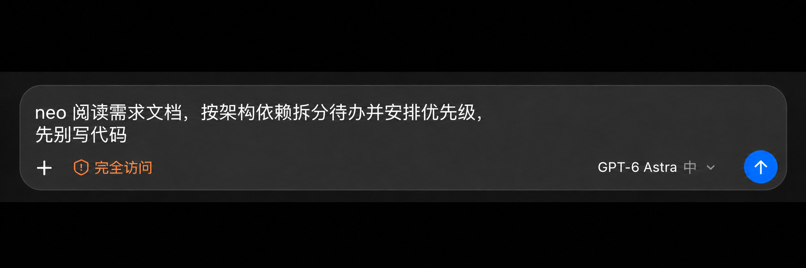

<div align="center">


# Next One


**你和 Coding Agent，共同维护一份待办上下文。**

为 Vibe Coding 而生的本地 macOS 悬浮待办，让计划、进度和下一步始终在眼前。

[English](../../README.md) · **简体中文** · [日本語](README.ja.md) · [한국어](README.ko.md)

macOS 14+ · SwiftUI + AppKit · 本地存储 · Codex Skill + CLI

</div>

**[下载 macOS 预览版](https://github.com/Lucas-Qinlj/Next-One/releases/tag/v0.1.0-preview.1)** · Apple Silicon · macOS 14+ · 尚未签名公证 · 仅限非商业用途。

**置顶伴随开发，透明度按需调整，现成指令复制给 Agent 即可开始接入。**

## 为什么需要 Next One？

和 AI 一起写代码很快，但跟上项目进度并不总是那么容易。

“这个以后再做”埋进了聊天记录；换一个会话，又要重新解释背景；你自己的清单和 Agent 理解的进度逐渐脱节；几个项目来回切换后，很难记清哪些真正完成了，哪些还需要验证。

**Next One 让你与 Coding Agent 共同维护一份持久化、按项目组织的待办。** 你在悬浮应用里查看和编辑，Agent 通过 CLI 读写同一份本地数据。目标、进度、验收条件和剩余工作都留在任务里，下次会话可以直接读取。

它面向独立开发者、个人创作者，以及通过与 Coding Agent 对话来构建软件的人。目前内置 **Codex** 接入；其他本地 Agent 可以使用公开的 CLI 接口，但尚未验证专用集成。

## 从一句 `neo` 开始

在**设置 → Codex 接入**复制指令，安装或更新 `next-one` Skill，并让本机 Coding Agent 发现它。之后直接输入 `neo`，再说你要记录或调整的事情。



*Coding Agent 输入框示意，展示尚未发送的指令，不代表执行成功。模型和权限控件按参考界面保留，不是 Next One 的使用要求。*

> neo 阅读需求文档，按架构依赖拆分待办并安排优先级，先别写代码

| 场景 | 直接对 Agent 说 | 留在 Next One 里的内容 |
| --- | --- | --- |
| 需求很长，不知道从哪下手 | `neo 按 docs/PRD.md 拆出当前项目的开发待办和子任务，每项写清验收条件，先别写代码` | 从需求到可执行清单，不用再手动抄一遍 |
| Agent 写得快，但开发顺序容易乱 | `neo 结合现有架构重排待办：先数据模型和接口，再页面联调；标好优先级，把依赖和理由写进备注` | 任务顺序、优先级与判断依据，方便随时检查 |
| 产品想法一闪而过，不想打断当前开发 | `neo 记个产品想法：新用户首次进入时给一份示例项目。放低优先级，备注待验证，暂时不开发` | 想法有地方放，也不会被当成已确认需求 |
| 老板临时插单，怕遗漏也怕打乱原计划 | `neo 老板要求本周五演示前补上数据导出和权限说明，拆成两条高优先级待办，保留原有任务` | 交办内容、期限和优先级，原计划仍保留 |
| 准备换会话，不想再解释一遍 | `neo 把这轮已验证的工作标完成，未通过的测试和阻塞写回对应任务，备注下一步从哪里继续` | 实际进度、验证缺口和下一步，供新会话接续 |
| 演示就在明天，想先知道还差什么 | `neo 根据当前任务和验收记录，列出明天演示前还没完成的事项，按影响排好；缺少证据的不要算完成` | 从真实记录查缺口，减少“代码写完了就算完成”的误判 |

把需求变成清单，把插单和想法留住，把进度交给下一次会话。Agent 读取你指定的文档和可访问的项目上下文，完成拆解与架构判断，再将结果写入 Next One 的任务、子任务、优先级和备注；依赖以备注记录，不是应用内自动调度。找不到文档、归属不清或有同名任务时先澄清，写入成功后才反馈。

这是 Skill 的触发约定，不是终端命令或后台监听。内置安装指令面向 Codex，是否发现 Skill 取决于 Agent 和安装版本；新会话自动路由仍待验证。

## 界面预览

<table>
<tr><th align="left">工作进度，随时可见</th><th align="left">上下文，留在任务里</th></tr>
<tr>
<td width="50%"></td>
<td width="50%"></td>
</tr>
</table>

截图来自实际运行的 macOS 应用，使用虚构演示任务。应用支持简体中文、英文、日文和韩文。在设置顶部选择语言或跟随系统，即时生效并记住选择；待办和项目内容保持原文。

## 主要功能与亮点

| 功能 | 带来的价值 |
| --- | --- |
| **人与 Agent 共用上下文** | 应用和 CLI 读写同一份待办。Agent 的更新会显示在运行中的应用里；应用关闭时 CLI 仍可工作。 |
| **按项目接续工作** | 绑定项目文件夹，根据工作目录读取对应任务；同一项目的其他 worktree 可显式追加绑定。 |
| **置顶伴随开发** | 让清单留在编辑器或 Agent 对话旁，查看下一步不用反复切换待办应用；可移动、缩放，也可收起为悬浮球。 |
| **透明度自由调整** | 背景不透明度支持 0%–100%，减少面板的视觉遮挡，文字和悬浮球仍保持清晰。 |
| **复制即用的接入指令** | 设置里一键复制当前语言的 Codex 安装指令，自动带上实际 Skill、CLI 和数据路径，无需自己拼接接入提示词。 |
| **任务承载完整背景** | 最多十层子任务，支持描述、状态、优先级、颜色及截止日期或时间。 |
| **灵活整理** | 折叠项目组，拖动任务与项目排序，移动整条分支，将未分类待办合并成项目。 |
| **自动保存与冲突保护** | 停止编辑后自动保存；不同字段的修改可以合并，同字段冲突保留草稿并请求处理。 |
| **参考资料与恢复** | 图片和视频保存为本地托管副本，单文件最大 100 MB；删除的任务和附件可以恢复。 |
| **本地优先** | SwiftUI、AppKit 与系统 SQLite，无需 Next One 账号、云端后端或额外 AI API Key。 |

锁定模式让面板忽略鼠标输入，悬浮球仍可用于解锁。部分跨应用与桌面组合还需要人工验证，见下方“当前状态与限制”。

## 少切窗口，少配置，把注意力留给开发

**待办置顶，下一步随时可见。** 点击图钉，让清单显示在当前桌面的普通窗口之上，写代码、查看 Agent 回复时都能随手看进度。需要更多空间时收起成悬浮球，不必来回寻找另一个待办窗口。

**透明度按需调整，保留清晰文字。** 在设置里将**背景不透明度调为 0%–100%**，让面板更融入工作区。透明度只作用于背景，文字和悬浮球保持清晰；置顶与透明度可以分别调整。

**现成指令，一键复制给 Agent。** 打开**设置 → Codex 接入**，点击复制图标，把完整指令粘贴到本机 Codex 对话中发送。应用已准备好实际路径、安装步骤、保留已有 Skill 自定义内容的要求和只读验证方式，省去自己查路径、拼指令的过程。指令跟随当前界面语言；发送后才由 Codex 执行安装，单纯复制不会安装。当前内置指令面向 Codex，其他 Coding Agent 可通过公开的本地 CLI 接入。

<p align="center"></p>

*此设置截图拍摄于更名前，仅展示布局；接入时复制当前应用生成的路径，不照抄图中旧路径。*

## 你与 Agent 如何一起工作

1. **记录目标。** 创建项目、绑定目录，写下目标、约束和验收条件。
2. **带着上下文开工。** 让 Codex 先读取当前项目未完成的任务。
3. **共同维护进度。** 你在应用里调整优先级和备注，Agent 通过 CLI 记录真实进展。
4. **留下可接续的交接。** 把完成结果与待验证事项写回任务。后续本机会话可以读取同一份清单，不必从聊天中重新整理。

完成接入后，可以这样说：

> 先读取当前项目的 Next One 待办，继续开发新用户引导流程。把明确的后续工作记成子任务，根据实际验证结果更新进度，保留我已有的备注。

```text
你 ───────── macOS 应用 ────┐
                           ├── 共享业务校验 ── 本地待办与附件
Coding Agent ─ Skill / CLI ─┘
```

这是明确指令驱动的协作：Next One 不监听全部聊天，不在后台运行 Agent，也不自动同步远程环境。

## 快速开始

### 从源码构建并运行

需要 **macOS 14 或更高版本**、**Swift 6.0+ 工具链**（例如兼容的 Xcode）以及打包脚本使用的 Python 3。没有第三方运行依赖。

```sh
git clone https://github.com/Lucas-Qinlj/Next-One.git
cd Next-One
./scripts/run.sh
```

脚本构建并启动 `.build/Next One.app`，包含 CLI 与 Skill 资源，不安装到 Applications。这是本地开发构建，尚非签名、公证后的分发版。

- 单击悬浮球展开或收起，拖动球移动窗口。
- 点击 **+** 新建任务，点击任务标题编辑详情，修改自动保存。
- 在 **设置** 中绑定项目文件夹，并找到 **Codex 接入**。
- 右键球可以锁定、解锁或退出；菜单栏入口可以找回悬浮球。
- 快捷键：`⌘B` 找回球、`⌘T` 展开/收起、`⌘,` 设置、`⌘Q` 退出。

### 接入 Codex

1. 启动 Next One，打开 **设置 → Codex 接入**。
2. 复制安装指令，发送到**同一台 Mac 上的本地 Codex 会话**。指令要求该会话安装应用携带的 Skill，保留已有自定义内容，并通过只读命令验证 CLI。
3. 项目工作绑定目录；生活事项可直接放未分类，额外 worktree 需要显式绑定。
4. 确认新版 Skill 可用后发送 `neo` 指令；若会话尚未发现 Skill，刷新或重启 Agent 会话。

仅复制指令不会安装任何内容。应用启动只会在自身数据目录准备接入资源，不修改全局 Skill 或 Codex 配置。安装后的自动发现仍需在新的目标会话中验证。

详细说明：[内置 Skill](../../Skills/next-one/SKILL.md) · [CLI 接口](../../Skills/next-one/references/cli.md) · [可选持续规则](../codex-rules-snippet.md)。Skill、CLI/neo 参考文档及可选持续规则均使用英文编写；用户请求与任务内容仍可使用中文等语言。

### 直接使用 CLI

构建后在仓库根目录执行：

```sh
.build/debug/todo --help
.build/debug/todo project bind --path "$PWD" --name "Next One"
.build/debug/todo context --cwd "$PWD" --json
```

绑定命令为当前仓库目录创建或关联项目；绑定其他项目时改用其目录。命令返回结构化 JSON，失败返回明确错误码和非零退出状态。

更新需要任务最新的 `revision`，创建支持稳定请求键以避免重试产生重复任务。两种入口遵守同一套层级、项目与状态规则；Agent 应使用 CLI，不直接编辑数据库。

## 数据与隐私

- Release 使用 `~/Library/Application Support/Next-One-Release`；debug 使用 `~/Library/Application Support/Next-One`。同渠道旧目录存在而新路径不存在时，新路径链接到原存储，保留任务、附件和偏好，不复制或合并数据。已有新目录优先；新旧目录均不存在时才从空清单开始。开发版和安装版数据仍独立。
- 旧 Skill 请用当前应用设置中的指令更新：Skill 名为 `next-one`，导出 CLI 为 `integration/current/bin/next-one`，`NEXT_ONE_HOME` 可覆盖数据目录。旧变量 `TODO_AI_HOME` 仅作兼容，新变量优先。单纯复制指令不会更新全局 Skill。
- 附件导入时复制到托管目录，原文件移动不会影响副本；视频播放依赖系统默认媒体应用。
- 已删除的任务和附件可恢复，不自动清空回收站。
- Next One 不自动上传待办或附件。你明确让 Coding Agent 读取的内容会进入该 Agent 的上下文，并遵循其数据处理方式。
- 备份前退出 UI 并停止 CLI 写入，再复制完整数据目录，包括 SQLite/WAL 文件和附件。

演示或测试使用隔离目录，应用与 CLI 必须设置**相同的** `NEXT_ONE_HOME`：

```sh
NEXT_ONE_HOME="$PWD/.local/demo" ./scripts/run.sh
# 在另一个终端中，进入同一仓库后执行：
NEXT_ONE_HOME="$PWD/.local/demo" .build/debug/todo project list
```

同一数据目录只运行一个 UI 实例；CLI 可并发调用。

## 开发

```sh
swift build
swift test
python3 scripts/cli-smoke.py
python3 scripts/drag-cli-smoke.py
./scripts/package-app.sh release
```

最后一条命令生成优化后的本地应用包 `.build/Next One.app`，不会签名、公证、安装或发布。移动时保留完整应用包及其中的 CLI、Skill 资源。

| 模块 | 职责 |
| --- | --- |
| [TodoCore](../../Sources/TodoCore/README.md) | 持久化、事务、任务规则与冲突校验 |
| [TodoApp](../../Sources/TodoApp/README.md) | 悬浮窗口、任务界面与本地接入资源准备 |
| [TodoCLI](../../Sources/TodoCLI/README.md) | 面向 Agent 和脚本的结构化接口 |
| [Skills/next-one](../../Skills/next-one/SKILL.md) | Codex 读取和更新待办的约定 |

本机试装可执行 `./scripts/package-dmg.sh`，生成可拖入 Applications 的 DMG 和 SHA-256 校验文件，位于 `.local/releases/`。详见[本机安装说明](../distribution/local-install.md)。试装包尚未进行 Developer ID 签名或 Apple 公证。

## 当前状态与限制

原生应用和 CLI 已实现，并在 Apple Silicon 上构建运行。目前仍是早期本地开发版本，尚未通过全部验收场景。

- 签名公证下载包、跨机器分发及跨架构验证尚未完成。
- 背后应用实际接收穿透输入、多显示器变化、Spaces、全屏与 Stage Manager 尚未完成全面验证。
- 部分媒体交互及新会话发现 Skill 仍需端到端检查。
- 不提供云同步、多人工作区或远程 Agent 自动访问本机数据的保证。
- `docs/` 下的像素鱼缸实验是独立原型，不是原生应用已有功能。

实际证据及剩余工作见[项目状态](../../PROJECT_STATUS.md)、[验收报告](../acceptance/macos-floating-todo.md)与[产品 Spec](../spec/2026-10-24/macos-floating-todo.md)。

## 参与贡献

欢迎提交问题复现、文档改进和范围清晰的修改。反馈问题时提供 macOS 版本、构建步骤、预期与实际结果，使用演示数据，并移除私人待办、路径和凭据。

修改前阅读 [AGENTS.md](../../AGENTS.md) 和相关 Spec。保持产品面向单人、本机以及人与 Coding Agent 协作的简单方向；行为变化按需验证相关测试和真实 macOS 交互。

## 许可证

**仅限非商业用途，不得商用。** Next One 使用 [PolyForm Noncommercial License 1.0.0](../../LICENSE)。在条款规定范围内允许非商业使用、修改和再分发，商业用途不在授权范围内；分发时须保留许可证和[版权声明](../../NOTICE)。这是带非商业限制的源码可用许可，不是允许自由商用的开源许可。第三方组件仍遵循各自许可证。

授权后，`integration install` 安装稳定 Skill 入口与专属 Codex 持续规则。应用更新后通过 `integration/current` 读取新版规则和 CLI，保留 `USER.md`；遇到非托管或人工修改内容会拒绝覆盖。`integration status` 只读检查，`integration uninstall` 仅移除未修改的管理内容。详见[接入说明](../../Skills/next-one/references/setup.md)。
